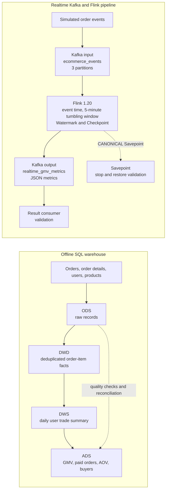

# Ecommerce Data Platform Demo

本地电商数据开发实践，包含离线订单数仓与 Kafka + Flink 实时指标链路。

项目使用合成数据，定位为个人工程练习，不是生产集群或企业真实业务系统。

## Architecture



## Verified Capabilities

| Area | Implementation |
|---|---|
| Offline modeling | ODS, DWD, DWS and ADS tables in SQL |
| Data quality | Duplicate keys, invalid amounts, orphan orders and invalid statuses |
| Reconciliation | Source-to-ADS checks for GMV and paid order count |
| Kafka | Kafka 3.9.1 KRaft, 3-partition input and output topics |
| Flink | Flink 1.20.1 DataStream, event time, Watermark and 5-minute windows |
| Reliability | 5-second Checkpoint and CANONICAL Savepoint restore |
| Output | JSON metrics written to Kafka with At-Least-Once delivery |

The realtime job produced 16 validated JSON metric records. The project also verified restoration of the Kafka source state from a Savepoint and continued output after recovery.

## Repository Layout

```text
.
├── offline/
│   ├── scripts/build_practice.py
│   └── sql/
├── realtime/
│   ├── data/
│   └── src/main/java/training/EcommerceRealtimeJob.java
├── docs/
│   ├── architecture.md
│   └── interview-notes.md
└── evidence/
    ├── flink-window-output.jsonl
    ├── run-summary.md
    ├── savepoint-recovery.md
    └── images/
```

## Offline Pipeline

The offline exercise uses Python's built-in SQLite module. It requires no database server or external Python package.

Requirements:

- Python 3.10 or newer

Run:

```bash
python offline/scripts/build_practice.py
```

The script creates `offline/warehouse.db` and prints:

1. Daily ADS trade metrics.
2. Data quality rule results.
3. Source-to-ADS reconciliation.

Core DWD grain:

> One row represents one order item in a paid or completed order.

## Realtime Pipeline

Requirements:

- JDK 17
- Apache Kafka 3.9.1
- Apache Flink 1.20.1
- Flink Kafka connector compatible with Flink 1.20

Steps:

1. Start Kafka.
2. Create `ecommerce_events` and `realtime_gmv_metrics`, each with 3 partitions.
3. Compile `realtime/src/main/java/training/EcommerceRealtimeJob.java` against the Flink libraries.
4. Start the Flink job.
5. Produce the sample events from `realtime/data/`.
6. Consume `realtime_gmv_metrics` to verify JSON output.

Example compile command on Windows:

```powershell
$FLINK_HOME = "C:\path\to\flink-1.20.1"
javac -encoding UTF-8 `
  -cp "$FLINK_HOME\lib\*" `
  -d realtime\classes `
  realtime\src\main\java\training\EcommerceRealtimeJob.java
```

The job arguments are:

```text
<kafka-bootstrap-servers> <input-topic> <checkpoint-directory>
```

Default values:

```text
127.0.0.1:9092
ecommerce_events
<local checkpoint directory>
```

## Example Output

```json
{"windowStart":"2026-11-19T16:55:00Z","windowEnd":"2026-11-19T17:00:00Z","paidOrders":2,"gmv":598.00,"buyers":2}
{"windowStart":"2026-11-19T17:00:00Z","windowEnd":"2026-11-19T17:05:00Z","paidOrders":2,"gmv":798.00,"buyers":2}
```

## Project Boundaries

This repository does not claim:

- Production high availability or multi-node deployment.
- End-to-end Exactly-Once semantics.
- Database or Redis result sinks.
- Hive, Spark or Hadoop production operations.
- Real enterprise business data or commercial impact.

The realtime Kafka sink uses At-Least-Once. A production design would add an idempotent database sink, unique window keys, monitoring and stronger failure testing.

