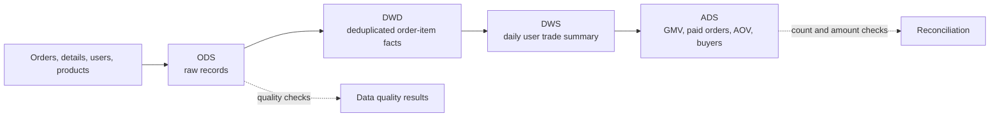
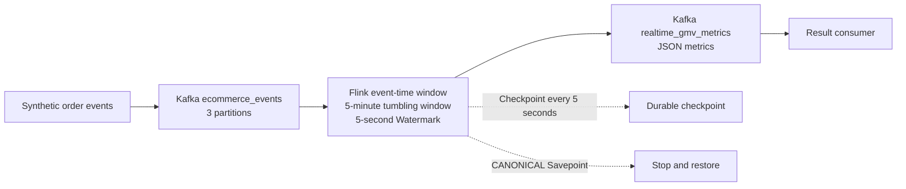

# Project Architecture

## Offline SQL Warehouse

## Realtime Metrics

## Data Flow

1. Synthetic payment events are produced into `ecommerce_events`.
2. Flink reads the topic and assigns event-time timestamps.
3. A bounded-out-of-orderness Watermark tolerates five seconds of disorder.
4. Payment events are aggregated into five-minute tumbling windows.
5. Each window emits `windowStart`, `windowEnd`, `paidOrders`, `gmv` and `buyers`.
6. KafkaSink writes the JSON result to `realtime_gmv_metrics` with At-Least-Once delivery.
7. Checkpoints store job and source state.
8. A CANONICAL Savepoint was generated, the original job was stopped, and a new job restored the Kafka source state.

